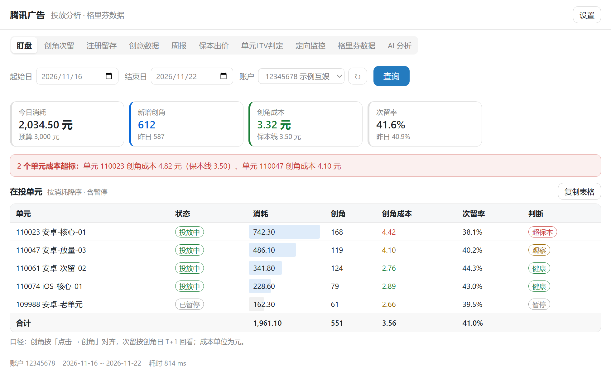
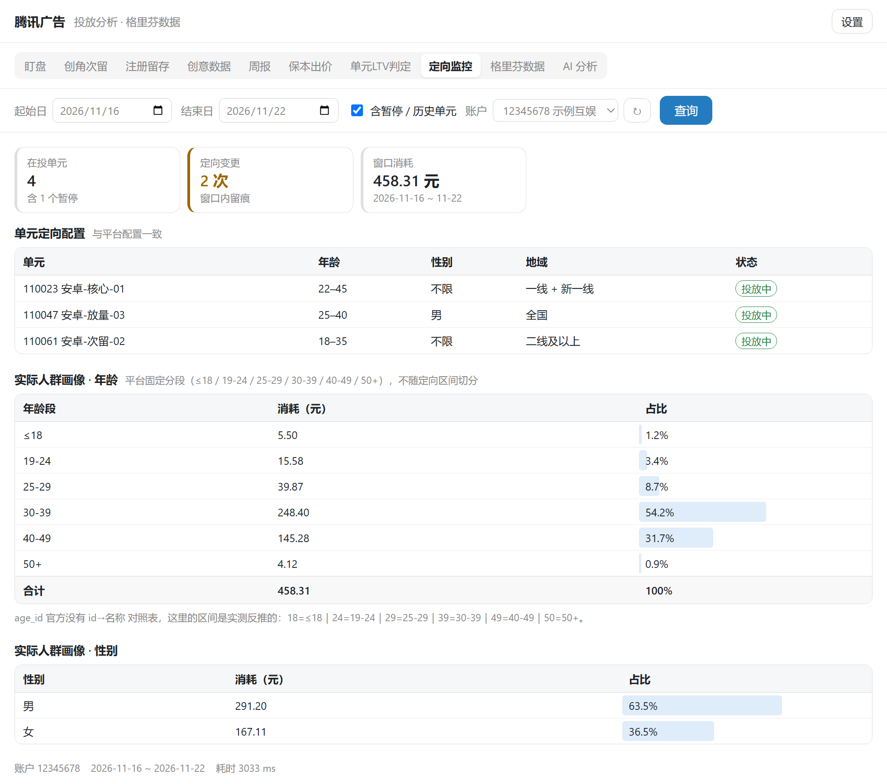
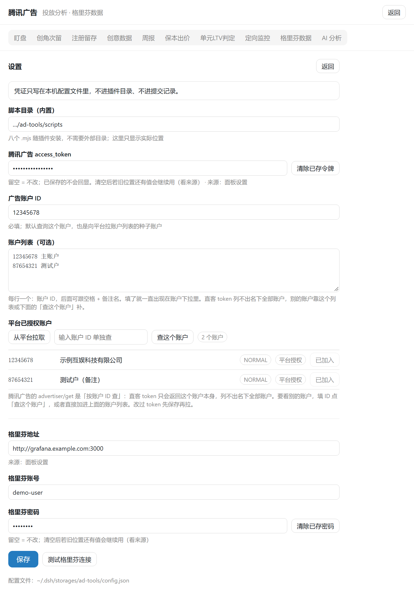

# 腾讯广告工具箱 · DSH 插件

把腾讯广告的日常投放分析和格里芬（Grafana）取数收进 [DSH](https://dsh.ai) 右侧栏：八个分析工具
一个面板出结果，主对话也能直接取数分析。不用再复制表格，也不用另起一个本地网页服务。

作者技术博客：**[www.webgou.info](https://www.webgou.info/)**
详细设计与口径说明：[docs/DETAIL.zh.md](docs/DETAIL.zh.md) · [English](docs/DETAIL.md)



## 功能

| 页签 | 说明 |
| --- | --- |
| 盯盘 | 在投单元的成本 / 次留 / 超标告警 |
| 创角次留 | 逐日、版位、素材三个维度的错位口径 |
| 注册留存 | 注册成本与后台口径次留 |
| 创意数据 | 计划 × 创意，含暂停建议与三张榜 |
| 周报 | 四段固定模板，可导出 Markdown |
| 保本出价 | 目标人群 LTV 上限 |
| 单元LTV判定 | LTV ÷ CAC，加量 / 观察 / 停 |
| 定向监控 | 定向配置 vs 实际人群，含变更留痕 |
| 格里芬数据 | 六套固定报表 SQL + 自定义只读 SQL |
| AI 分析 | 直接对面板上已查出的数据追问，默认走 DSH 内置模型 |

- **主对话取数**：插件向 DSH 注册 `ad_tools_report` / `ad_tools_last_report` 两个工具，模型可以直接
  跑某个工具、读取刚在面板查出的报告，凭证不出 Host。
- **账户切换**：参数行的账户下拉，配合设置里的手动账户列表和「查这个账户」。
- **素材预览**：创意数据里的素材点开即看，链接现取现用。

## 截图

定向监控 —— 定向配置和平台实际人群分开看，年龄按平台固定分段展示：



设置 —— 凭证、账户列表、平台账户查询都在这里，凭证只落在本机配置文件：



> 截图中的账户 ID、公司名和投放数据均为示例，与真实账户无关。

## 安装

插件本体就是这个仓库。在 DSH 配置档 `~/.dsh/profiles/desktop/package.json` 里登记：

```json
{
  "dependencies": {
    "@local/ad-tools": "link:<本仓库的绝对路径>"
  },
  "dsh": {
    "profile": {
      "bundles": ["@local/ad-tools"]
    }
  }
}
```

在 profile 目录建一次 `node_modules/@local/ad-tools` 指向本仓库的 junction（或在依赖里直接写好路径），
重启 DSH。左侧栏会多出「腾讯广告」入口，点开后面板在右侧栏显示；右侧栏「开始」页也有同一张卡片。

## 配置

第一次打开先点面板右上角「设置」：

| 项 | 说明 |
| --- | --- |
| 腾讯广告 access_token | 腾讯广告 API 令牌 |
| 广告账户 ID | 默认查询账户，也是向平台拉账户列表的种子账户 |
| 账户列表 | 可选，一行一个「账户 ID + 备注名」，见下 |
| 格里芬地址 / 账号 / 密码 | Grafana 登录信息 |
| 主库 / 小七库数据源 UID | 格里芬两个 MySQL 数据源 |
| DeepSeek API Key | 可选；不填也能用 DSH 内置模型做 AI 分析 |

所有配置写在 `~/.dsh/storages/ad-tools/config.json`（0600），不进仓库、不回显到浏览器；
也能用环境变量 `MKT_ACCESS_TOKEN` / `MKT_ACCOUNT_ID` / `GRAFANA_URL` / `GRAFANA_USER` / `GRAFANA_PASS` 覆盖。

## 账户列表怎么来的

账户下拉是这几处合并、按 ID 去重：

1. 设置里的**账户列表**（手动维护，备注名优先于平台工商名）；
2. 设置里的**默认账户**；
3. `advertiser/get` 查到的账户信息；
4. 旧凭证文件里的 `known_accounts`（迁移兼容，只读）。

注意 `advertiser/get` **不是「列出名下全部账户」**：它必须带一个 `account_id`，直客 token 只会返回
被查询的那个账户本身；只有服务商 token 才能列名下子客（`agency/get` 对直客 token 直接回 `132307`）。
所以：

- 「从平台拉取」= 查默认账户 + 把手动列表里的账户逐个补上工商名和状态；
- 「查这个账户」= 输入任意账户 ID 单独查，查到后可以「加入列表」固定下来；
- 参数行账户下拉旁的 `↻` 是不进设置就能刷新账户的快捷按钮。

## 安全

- 所有路由挂在 DSH 自己的 `connection` 上，仅 POST、仅本机 UI 可达；不监听任何对外端口。
- 唯一的监听是跑保本出价 / 单元LTV 时临时开的回环 SQL 桥：`127.0.0.1`、随机端口、只读单条
  `SELECT`，跑完 60 秒空闲自动关闭。
- 凭证只存在 `~/.dsh/storages/ad-tools/config.json`（0600），不写进插件目录、不进提交记录；
  浏览器侧只能看到「是否已配置」，看不到原文。
- 插件完全活在 DSH 进程里：关掉 DSH，面板、回环桥和正在跑的脚本一起结束。

## 目录结构

```
index.js            Host 半：注册路由和主对话工具
client.js           浏览器半：面板 UI（React，DSH 侧栏席位）
lib/                凭证解析、报告归一、格里芬查询、回环桥、AI 分析
scripts/            八个投放分析脚本（随插件安装，可直接 node 运行 --json）
docs/               详细设计与截图
locale/             中英文案
cordis.patch.yml    DSH bundle patch
```

`scripts/*.mjs` 只依赖 Node 内置模块，单独运行也可以：

```bash
MKT_ACCOUNT_ID=12345678 node scripts/盯盘.mjs --json
```

## 开发

- `client.js` 与 `index.js` 都是普通 ESM/CommonJS 模块，无构建步骤；
- 运行产物写到 `~/.dsh/storages/ad-tools/run/`（可用 `AD_TOOLS_TMP` 改）；
- 脚本目录可用 `AD_TOOLS_SCRIPTS_DIR` 临时指向别处，便于对上游副本做对照。

## English

A DSH plugin that brings Tencent Ads delivery analysis and Griffin (Grafana) reporting into the DSH
right sidebar: eight analysis tools, a report model shared with the main conversation via
`ad_tools_report` / `ad_tools_last_report`, and credentials kept in a local 0600 config file.
See [docs/DETAIL.md](docs/DETAIL.md) for the full design, and
[www.webgou.info](https://www.webgou.info/) for the author's blog.
